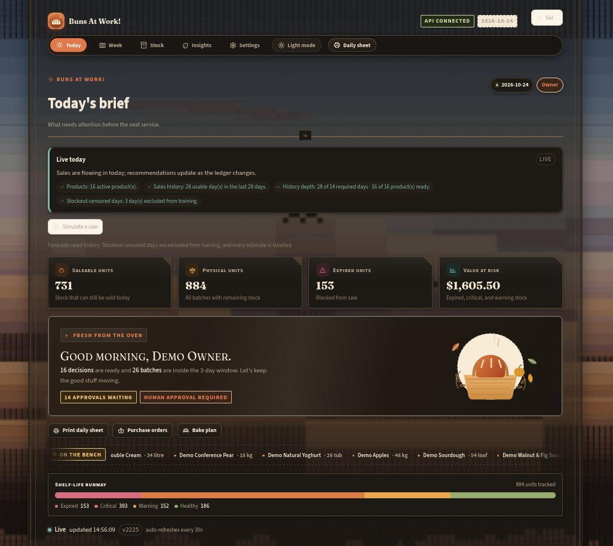

<div align="center">

# 🥖 Buns at Work!  🍞

Perishable Food Inventory AI Recommender System

**Reduce waste. Forecast demand. Meet the UN SDGs.**

[](https://sdgs.un.org/goals)
[](https://python.org)
[](https://fastapi.tiangolo.com)
[](https://streamlit.io)
[](https://sdc-dashboard.onrender.com/)
[](https://sdc-hackathon--polychch3.replit.app)

</div>


> A data-trust decision loop for small food shops and bakeries that refuses to guess when history is missing, imports messy sales CSVs safely, and separates forecast accuracy from causal impact claims with a person approving every money or customer-affecting action.

<p align="center">
    
</p>

---

## Team Information

| Field                  | Details                                     |
| ---------------------- | ------------------------------------------- |
| **Team Name**          | Monke |
| **Team Domain**        | Domain 2           |
| **SDG Track (1–17)**   | SDG 2.1, 2.4, 12.3, 12.5, 13.2 |
| **Team Leader**        | Sean Summertan Abraham |
| **University**         | Xiamen University Malaysia                          |
| **Number of Members**  | 5                                           |

## Links

| Resource          | Link                                           |
| ----------------- | ---------------------------------------------- |
| GitHub Repository | https://github.com/chuch3/sdc-hackathon    |
| Replit Project    | https://replit.com/@polychch3/sdc-hackathon |
| Live Demo | https://sdc-hackathon--polychch3.replit.app   |
| RunPod Endpoint   | https://api.runpod.ai/v2/us4ix85hcjrsyz      |
| Slide Deck        | https://canva.link/nspnlsmm6qwdsz3                     |
| Demo Video        | https://youtu.be/tqesys6fRl0?si=_dTNBV0G-71PeQvm                 |

---

## Overview

### Problem

An independent bakery or small food shop decides what to buy and bake from memory, habit, and a spreadsheet. It cannot see, batch by batch, what will expire first, how much will sell before then, or which products are already over-ordered. Short-dated food is discovered too late, and there is no simple approval trail for discounts, donations, or extra purchases. The business loses twice: spoiled food becomes waste, and empty shelves become lost sales as sharpest for bread, dairy, and produce, where a one-day forecast error becomes either waste or a stockout. This affects the owner or manager of a shop with roughly 5–50 staff.

### Solution

Buns at Work! is a thin decision layer that fits the SME's existing routine without replacing the till, accounting, or supplier systems. It uses AI (a rule-based, explainable demand forecast with an optional ML challenger) to turn live ledger data into a single daily list of evidence-backed actions: what to sell first, mark down, donate, buy, bake, or leave alone. Its value comes from **data trust**: it refuses to forecast when history is missing, imports messy CSVs without inventing saleable stock, refreshes decisions from the live ledger, and separates measured forecast accuracy from labelled impact projections. Every action is logged with a run ID, input snapshot, and approver, and a human approves every buying, baking, markdown, or donation action.

### Key Features

- **FEFO inventory ledger** — First-Expired-First-Out deduction across batches, with an immutable movement trail for food safety and audit.
- **Expiry risk & alerts** — Configurable buckets (expired, critical, warning, healthy) with markdown/donate/write-off advice and a hard block on expired sales.
- **Explainable forecasting** — Weekday/seasonal baseline with stockout-censored demand handling, confidence display, and a declared ML challenger that falls back to baseline.
- **Saleable-stock reorder logic** — ROP and safety stock using saleable on-hand, shelf-life cap, and near-expiry surplus suppression.
- **Bakery domain plugin** — Daily bake plan by weekday and daypart, seasonal ingredient advice, markdown windows, allergen checks.
- **Data-readiness gate & safe CSV import** — Preview, skipped-row reporting, stockout markers, idempotent commits that never alter today's saleable stock.
- **Human-in-the-loop approval workflow** — Draft → Waiting → Approved/Edited/Rejected/Expired → Done → Outcome logged; default is no action.
- **Weekly quest board** — Read-only seven-day projection with per-day action cards, workload bar, and activity heatmap.
- **SDG impact dashboard** — Waste, donation, CO2e, and availability KPIs labelled as estimates with assumptions shown.
- **30-second live loop** — Data version and changed-since card for fast refresh.

### Tech Stack

| Layer         | Technology                   |
| ------------- | ---------------------------- |
| Frontend      | Streamlit                    |
| Backend       | Python 3.11+, FastAPI        |
| Database      | SQLite via SQLAlchemy (Postgres-ready) |
| AI / Compute  | Rule-based forecaster (default); optional PyTorch + MLflow challenger on RunPod (GPU) |
| Hosting / Dev | Replit, Render               |


---

## Project Structure

```
.
├── docs/
├── src/
│   ├── api/
│   ├── core/
│   ├── db/
│   ├── models/
│   ├── schemas/
│   ├── services/
│   ├── domains/
│   ├── analytics/
│   └── main.py
├── dashboard/               # (or src/dashboard/, per README)
├── scripts/
├── forecast/
│   └── ml/
├── tests/
├── submission/
├── .env.example
├── .gitignore
├── .replit
├── LICENSE                  # Apache 2.0
├── requirements.txt
└── README.md
```

### Architecture

```
User ──► Replit (Streamlit dashboard + FastAPI) ──► RunPod Endpoint (optional ML challenger)
                │
                ├──► Service layer (inventory + FEFO, expiry risk, forecasting,
                │        reorder/planning, waste + donations, SDG metrics)
                │
                ├──► Domain policies (Strategy pattern): generic perishables | bakery
                │
                └──► SQLAlchemy → SQLite (Postgres-ready) → Response returned to user
```

**Why this design:** one inventory ledger for all domains (bread production is a receipt; sales and waste are issues); domain strategy avoids `if bakery` scattered through the codebase; FastAPI + Streamlit lets backend and UI work in parallel; SQLite is enough for the demo; rule-based recommendations are the default and the ML challenger must fall back to baseline.

---

## How to Run

### Option 1 — Run on Replit / Rend er (Recommended)

Open the [Replit Project](
https://sdc-hackathon--polychch3.replit.app
), or [Render Project](https://sdc-dashboard.onrender.com/)


> [!WARNING]
> The /api endpoint must be online in order to start the dashboard. 
In production, the database API must be actively online to handle requests
from the dashboard from multiple users. [API](https://sdc-api-dqfi.onrender.com/docs#/)

### Option 2 — Run Locally

```bash
# 1. Clone the repository
https://github.com/chuch3/sdc-hackathon
cd sdc-hackathon 

# 2. Create and activate a virtual environment
python -m venv 
source venv/bin/activate        # Windows: venv\Scripts\activate

# 3. Install dependencies
pip install -r requirements.txt

# 4. Configure environment variables
cp .env.example .env            # then fill in your values

# 5. Run the API and the dashboard in two terminals
cd backend && uv run python -m alembic upgrade head && uv run python -m scripts.seed && uv run python -m scripts.start
uv run streamlit run src/dashboard/app.py
```

### Option 3 — Docker Compose

```bash
docker compose -f src/backend/compose.yaml up -d --build
```

Open the dashboard at <http://127.0.0.1:8501> and the API tester at <http://127.0.0.1:8000/docs>.

To rebuild the demo data from scratch:

```bash
docker compose -f src/backend/compose.yaml down -v
docker compose -f src/backend/compose.yaml up -d --build
```

For the data-trust demo, replace the seed command with `uv run python -m scripts.seed --skip-history`, open **Settings → Import sales**, and load `docs/samples/messy_sales.csv`. `--history-days N` controls how much synthetic history the seed creates.

### Run Tests

```bash
python -m pytest
```

---

## Core Decision Logic

### FEFO

When stock is issued: select available batches, sort by earliest expiry then earliest received/baked time, allocate until satisfied, record one movement per batch, and exclude expired/quarantined/donated stock.

### Expiry risk

`days_to_expiry = expiry_date - today`. Buckets: **Expired** (`< 0`), **Critical** (`0` to threshold), **Warning** (threshold to `2 × threshold`), **Healthy** (beyond warning). Thresholds are configurable: bakery 1 day, dairy 3 days, produce 2 days, meat 1–2 days. Risk score weights quantity by proximity to expiry and inventory value. Suggestions: markdown, donate, write off (only when expired/unsafe), stop replenishment.

### Forecasting

```
forecast = baseline_demand × weekday_factor × seasonal/holiday_factor × daypart_share
```

Trailing 28 days with fallbacks for new products; holidays/promotions as manual overrides; MAE/MAPE and bias measured on a holdout; stockout days flagged as censored demand. The optional ML challenger predicts q10/q50/q90 behind the same `Forecaster` interface, falls back on missing/stale/unseen/low-coverage products, and is promoted only if WAPE does not regress, bias stays within 10%, and 80% coverage lands near 80%. It never creates a stock movement or bypasses human approval.

### Reorder recommendation

```
ROP = forecast(lead_time + review_period) + safety_stock
safety_stock = z × forecast_error × sqrt(lead_time + review_period)
raw_order = ROP - saleable_on_hand - on_order
fresh_cap = forecast(min(remaining_shelf_life, lead_time + review_period)) - saleable_on_hand
recommended = max(0, min(raw_order, fresh_cap))
```

Round up to MOQ/case size; suppress and recommend markdown/donation if near-expiry surplus exists. Each recommendation returns `action: BUY | HOLD | REDUCE | MARKDOWN | DONATE | BAKE`, quantity, rationale, confidence, expiry risk, and forecast horizon.

### Bakery domain extension

Same inventory core, different planning policy. Weekend/Monday effects learned from sales; daypart demand shares (morning, midday, afternoon, evening); seasonal ingredient calendar and rule-based bread advice; markdown windows then donation before close; ingredient and allergen constraints checked against the bake plan. Example output:

```text
Saturday sourdough
Bake: 118 loaves
Morning: 65 | Midday: 35 | Afternoon: 18
Reason: weekend factor 1.18 × base 100, 6% buffer, no safe carryover
Advice: apple-walnut loaf is in season; markdown 30% after 17:30
```

---

## Automated Workflow with Human Control

The daily review follows one clear path: **Trigger → Data → Logic → Approval → Logged outcome**.

| Stage | What it means | In this system | Human control |
|---|---|---|---|
| **Trigger** | What starts the review | Daily at 06:00, plus when a batch enters its critical expiry window | Manager can pause the schedule; every run gets an ID |
| **Data** | The facts the system reads | Batch quantities/expiry, sales by weekday/daypart, open orders, lead times, seasonal ingredients, oven capacity | Sources and freshness shown; missing or stale data blocks action |
| **Logic** | Rules that turn data into a recommendation | Oldest-first handling, expiry risk, demand estimate, saleable stock, buy/bake quantity, markdown/donation suggestion | Rules and thresholds visible; person can override with a reason |
| **Approval** | The person who decides | Manager or head baker reviews evidence and approves, edits, or rejects | Required for purchases, markdowns, donations, bake-plan changes |
| **Logged outcome** | Record of what happened | Run ID, input snapshot, recommendation, decision, approver, time, actual result | Append-only; weekly review |

```text
State flow:
Draft → Waiting for approval → Approved / Edited / Rejected / Expired
      → Done or Not done → Outcome logged
```

**Human control rules:** automate watching and maths, people keep control of money/discounts/donations/production; default is no action; every recommendation explains itself in three short lines; approval limits are configurable by role; expired food can never be sold; allergen/ingredient checks can block a bake; overrides keep the original recommendation plus a reason; start with every action approved; one pause switch and a weekly review of waste, stockouts, and overrides.

---

## Business Benefit and SDG Link

| Business benefit | How it happens | How to measure | SDG link |
|---|---|---|---|
| Lower waste cost | Use oldest food first; mark down or donate early | Waste kg and value, expired stock value | SDG 12.3, 12.5 |
| Fewer empty shelves | Buy and bake closer to expected demand | Availability %, stockout days, lost sales | SDG 2.1 |
| Less cash tied up | Do not order more than can sell before expiry | Inventory days, overstock value | SDG 12.3 |
| Less manual work | Daily list replaces spreadsheet checking | Minutes per day, manual checks | Efficiency benefit |
| Better margin recovery | Discount before spoiling instead of dumping | Markdown recovery %, donation kg | SDG 12.5 |
| Safer food and clearer records | Batch traceability and approval log | Expired sales (target zero), audit completeness | SDG 2.1, 12.3 |
| Seasonal and local menu | Bakery advice uses in-season ingredients | Seasonal/local ingredient %, seasonal sales | SDG 2.4 |
| Lower emissions | Avoid waste and overproduction | Estimated kg CO2e avoided | SDG 13.2 |
| Community support | Safe surplus goes to donation partners | Kg donated, meals equivalent | SDG 2.1 |

| SDG target | System contribution | KPI |
|---|---|---|
| **SDG 2.1** — safe, nutritious food access | Reduce stockouts; route safe surplus to donation partners | Availability %, donation kg, meals equivalent |
| **SDG 2.4** — sustainable food production | Seasonal/local ingredient advice; demand-aligned baking | Seasonal/local ingredient %, overproduction % |
| **SDG 12.3** — halve food waste | FEFO, expiry alerts, demand-based buying/baking, markdowns | Waste rate %, expired stock value, surplus units |
| **SDG 12.5** — waste prevention | Markdown/donation before waste; waste analytics | Kg diverted from waste, markdown sell-through |
| **SDG 13.2** — climate integration | Avoided waste and overproduction reduce emissions | Estimated kg CO2e avoided |

Report these as **estimated contributions**, not certified SDG impact. Show the baseline policy, assumptions, and emission factors. Measure a baseline for two to four weeks before the pilot and present results as estimates with assumptions, not guaranteed savings.

---

## Ease of Learning

A new manager should get value in 15 minutes and finish the daily review in under 5 minutes.

- A guided first run with a sample shop and plain labels: "use first", "buy now", "bake plan".
- One main daily screen. Every recommendation has a short "why".
- Approve, edit, or reject in one click. Overrides need a short reason.
- A safe practice mode, undo, inline help, a glossary, and short videos.
- Different views for the owner, manager, baker, and shop staff.
- A 30-minute owner session, a 15-minute staff session, and a one-page quick card.
- Success measures: first useful recommendation in under 15 minutes, 80% of users complete the daily review without help, daily routine under 5 minutes, and support questions tracked.

---

## Five-Day Timeline

| Day | Focus | End-of-day gate |
|---|---|---|
| **Day 1** | Foundations: scope, SDG KPIs, ERD, API contract, domain interfaces, repo, schema, synthetic data, Streamlit shell | App starts, seed data loads, schema/API/domain contracts frozen |
| **Day 2** | Inventory truth: products, batches, receipts, sales, waste, FEFO, expiry buckets/alerts, baseline forecast, inventory view | Demo: add batch → sell → FEFO deducts → expiry alert appears |
| **Day 3** | Decisions: safety stock, reorder quantities, saleable on-hand, near-expiry actions, bakery profiles, bake plan, seasonal advice, KPI dashboard | Scenario review passes; every recommendation has a reason code |
| **Day 4** | Integration and hardening: E2E tests, edge cases, backtests, indexes, CSV export, Docker optional, docs | Clean-slate demo works; test suite green; no P0 bugs |
| **Day 5** | Polish and storytelling: final fixes, README, SDG report, slides, screenshots, rehearsal | Feature freeze at noon; 5-minute demo delivered; tagged release |


Daily rhythm: 15-minute standup, merge by 16:30, checkpoint demo at 16:45. The gate must pass before starting the next day's work. Day 1 also agrees the problem, workflow, approval rules, and platform fit; Day 3 adds benefit measures; Day 5 adds the learning guide and quick card.

---

## How We Use Replit *(Required)*

- **Development:** Collaborative coding in a shared Repl using Multiplayer.
- **Hosting:** The app is deployed with Replit Deployments at the Live Demo link above.
- **Secrets:** API keys (`RUNPOD_API_KEY`, `RUNPOD_ENDPOINT_ID`) are stored in Replit Secrets, never in the code.

📄 Proof of use: [`submission/SDC2026_Monke_Replit_POU.pdf`](submission/SDC2026_Monke_Replit_POU.pdf)

## How We Use RunPod *(Required)*

- **Workload:** The optional ML forecaster (q10/q50/q90 demand prediction with a global model and product/category embeddings) runs inference on a RunPod GPU. The rule-based baseline runs on Replit as the default.
- **Setup:** `runpod/handler.py` is deployed as a **RunPod Serverless Endpoint**. Build it with `docker build -f runpod/Dockerfile -t <dockerhub-user>/freshstock-runpod:latest .`, push the image, then create a Serverless endpoint with `MODEL_PATH=/app/src/forecast/artifacts/model.pt` and `DEVICE=auto`.
- **Integration:** The Replit app sends requests to the endpoint using `RUNPOD_API_KEY` and `RUNPOD_ENDPOINT_ID`. If the endpoint is unavailable or the product is unseen/stale/low-coverage, the system falls back to the baseline forecaster.

Example request:

```bash
curl -X POST https://api.runpod.ai/v2/$RUNPOD_ENDPOINT_ID/runsync \
  -H "Authorization: Bearer $RUNPOD_API_KEY" \
  -H "Content-Type: application/json" \
  -d '{
    "input": {
      "product": {
        "sku": "sourdough",
        "name": "Sourdough",
        "category": "bakery",
        "domain": "bakery",
        "unit": "loaf",
        "shelf_life_days": 2,
        "lead_time_days": 1,
        "moq": 5,
        "case_size": 5
      },
      "horizon_days": 2,
      "sales_history": [28, 31, 27, 30, 29, 33, 35, 26, 28, 30, 32, 34, 36, 38]
    }
  }'
```

The endpoint returns `q10`/`q50`/`q90` per day, a total interval, confidence, reason codes, and the baseline fallback flag. Send `{"input": {"action": "health"}}` to check that the model checkpoint loaded.

📄 Proof of use: [`submission/SDC2026_TeamName_Runpod_POU.pdf`](submission/SDC2026_TeamName_Runpod_POU.pdf)

---

## Challenges & Learnings

- **Sparse demand data** — solved with fallback defaults, manual overrides, confidence display, and a hard ML-to-baseline fallback; never let ML output bypass the baseline gate.
- **Stockout-censored demand** — affected days are flagged and not trained on blindly.
- **Expiry/timezone bugs** — store UTC, compute local business dates, define whether expiry is start or end of day.
- **Concurrency** — allocation is wrapped in a database transaction; SQLite accepted for the demo.
- **Food safety** — hard block on expired sales; markdown/donation only within safe policy; allergens tracked.
- **Domain coupling** — bakery logic kept behind policy interfaces.
- **SDG overclaiming** — assumptions displayed; CO2e/meal figures labelled as estimates.
- **Integration risk** — contract-first development, daily merges, one clean-seed demo by Day 4.
- **Five days is tight** — MVP scope locked on Day 1; no feature additions after Day 4.

## Future Improvements

- [ ] Promote the ML challenger to default for high-coverage categories once the baseline gate passes.
- [ ] Multi-warehouse and multi-location support.
- [ ] POS/ERP integration to replace CSV import.
- [ ] Automated supplier emails for approved purchase orders.
- [ ] Full recipe/MRP planning for ingredient-level production.
- [ ] Mobile app for shop-floor approvals.
- [ ] Run a store-week switchback A/B to claim causal attribution (see `docs/AB_TEST_PLAN.md`).

## Team


| Name        | Role                | GitHub                                   |
| ----------- | ------------------- | ---------------------------------------- |
| Sean Abraham Summertan | Team Lead  | [@Deranged](https://github.com/dsc2409091 |
| Nicholas Marcel Tanjaya | Backend & Data  | [@nicho-mt](https://github.com/nicho-mt) |
| Deven Por Tirtanadi | Forecast / Inventory | None |
| Vincent William Wijaya | Bakery Domain       | [@chuch3](https://github.com/chuch3) |
| Nicholas Lawrence | UI / QA / Docs      | None  |


---

## Submission Checklist

- [x] Team name, domain (Domain 1 / Domain 2) and SDG track filled in
- [x] Slide deck link added
- [x] Demo video link added
- [x] Replit used, with proof of use in `submission/`
- [x] RunPod used, with proof of use in `submission/`
- [x] Preliminary submission completed (`SDC2026_TeamName_Preliminary.pdf`)
- [x] Technology declaration completed (`SDC2026_TeamName_TechDeclaration.pdf`)
- [x] Submission files renamed with your team name (replace `TeamName`)
- [x] "How to Run" steps verified
- [x] No API keys or secrets committed to the repository

## License

This project is licensed under the [Apache License 2.0](LICENSE).
