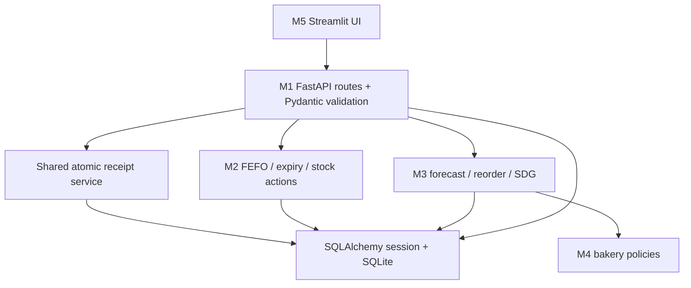
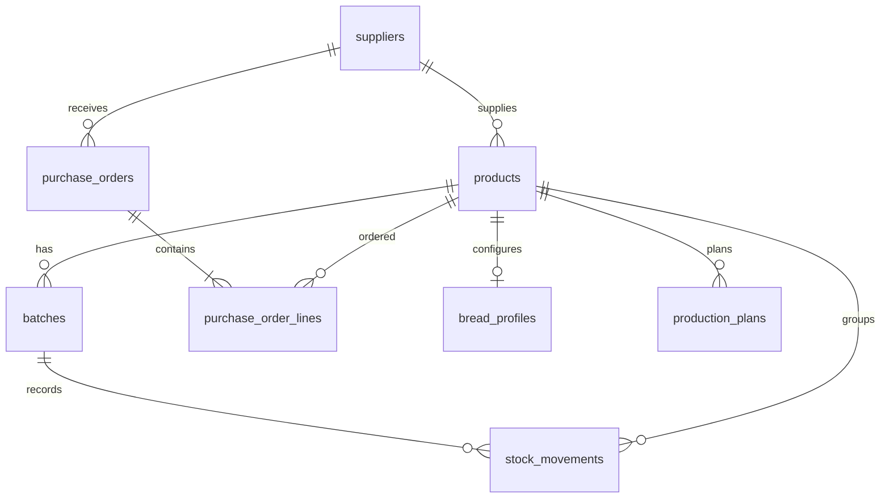

# Architecture and M1 explanation

## Entity relationships

Additional tables: `activity_events`, `seasonal_ingredients`, `holiday_calendar`, `settings`,
and `sdg_factors`. Stock history is read-only through the API; audit records are not claimed
to be cryptographically tamper-proof.

## File map

| File | Your reason for opening it |
|---|---|
| `app/models.py` | Add/change a database table or constraint, then create a migration. |
| `app/schemas.py` | Change what an endpoint accepts/returns. |
| `app/api.py` | Add/change an HTTP route. |
| `app/db.py` | Understand engine, sessions, FK enforcement, UTC handling and commits. |
| `app/config.py` | Environment variables and business-date settings. |
| `app/services/receipts.py` | Understand an atomic receipt plus ledger entry. |
| `app/services/stock_actions.py` | M2 integration boundary. |
| `app/services/recommendations.py` | M3 integration boundary. |
| `migrations/versions/` | Versioned database changes shared with the team. |
| `scripts/seed.py` | Team-created fictional fixture generation. |
| `tests/test_backend.py` | Meaningful data-integrity and API scenarios. |

## Invariants

1. A batch balance equals the sum of that batch's signed movement quantities.
2. A receipt and its opening movement either both commit or both roll back.
3. Remaining quantities never become negative or exceed received quantity in the current model.
4. Reusing a receipt request ID with changed input is a conflict, not a new receipt.
5. Archiving catalog records preserves old stock/history references.
6. Draft POs do not count as approved incoming stock; overdue POs are reported separately.
7. UTC timestamps and local calendar expiry dates are different types of information.

## M1 demo explanation

"The dashboard calls my API. Pydantic validates inputs. SQLAlchemy maps the validated data
to SQLite tables. When a batch is received, its receipt movement is saved in the same
transaction. The remaining stock is never directly edited from the dashboard. Alembic keeps
every team member's database structure consistent. M2 and M3 plug their services into the
same API and session, so the team shares one inventory source of truth."

## Deployment notes

Run locally with Python and Uvicorn for the demonstration. The Docker example binds the
container port to the local machine and persists SQLite in a named volume. Authentication,
real integrations, production hardening and multi-warehouse support are outside this MVP.
Switching to Postgres requires a driver, connection configuration, migrations and integration
testing; SQLAlchemy alone does not make a database switch automatically verified.

## Scope notes to discuss with the team

The full plan is ambitious for five days. Prioritise the core receipt -> approved stock action
-> expiry insight -> recommendation -> visible record. Keep one functioning use case for
the challenge; deeper bakery/seasonal features can follow after integration works.

SDG 12.3 is the strongest direct link for food waste. SDG 8 supports SME productivity.
Waste/CO2e/donation figures need a declared baseline, unit conversions and documented factors.
The starter does not certify food safety or provide actual measured sustainability outcomes.
